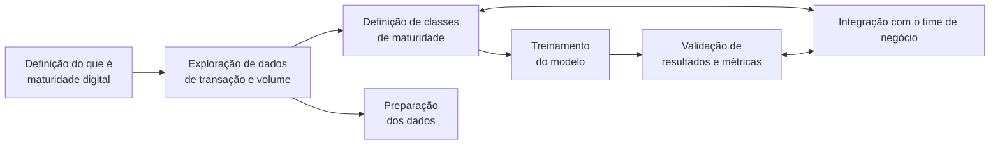

# Classificação da Maturidade Digital de Clientes de E-commerce — Desafio Inova Talentos | Cielo

Proposta de solução para o desafio técnico do programa **Inova Talentos – Cielo**: construir um modelo que classifique a **maturidade digital** dos clientes do segmento de e-commerce a partir de dados transacionais, e mostrar como esse modelo apoia a identificação de oportunidades de ampliação da atuação varejista desses clientes.

> **Candidata:** Rosemeire Aparecida Rosa Oliveira
> **Contexto:** Teste Inova Talentos – Cielo (apresentação de 14/08/2025)

---

## 📌 O desafio

Desenvolver um modelo de classificação da maturidade digital dos clientes do segmento de e-commerce da Cielo, respondendo:

1. Como abordar a criação do modelo a partir dos dados disponíveis nas transações e do volume de transações de cada cliente?
2. Além desses dados, quais outras variáveis poderiam ser incluídas?
3. Qual o passo a passo do processo, destacando as técnicas de análise estatística e *machine learning* utilizadas e por quê?
4. Como a aplicação do modelo pode auxiliar a Cielo a identificar oportunidades de ampliação da atuação varejista de seus clientes?

---

## 🗺️ Visão geral do projeto

O processo é iterativo: a definição das classes e a validação das métricas são feitas **em conjunto com o time de negócio**, e não de forma isolada.

---

## 🔎 Passo a passo

### Etapa 1 — Definir o que é "maturidade digital"

Maturidade digital é definida como o **nível de experiência do cliente em relação a compras de produtos de e-commerce da Cielo**, em três níveis:

| Nível | Perfil |
|---|---|
| **Baixa** | Poucas transações, baixo volume, longos intervalos entre compras, uso restrito de canais digitais. |
| **Média** | Frequência regular de transações, valor médio consistente, engajamento moderado com canais digitais. |
| **Alta** | Grande volume e frequência, alta diversificação de produtos/serviços, uso intenso de canais digitais. |

### Etapa 2 — Pré-processamento e exploração dos dados

Limpeza de dados ausentes e duplicados, ajuste de tipos das variáveis e codificação de variáveis categóricas (quando necessário).

Conjunto de dados de partida, com 3 variáveis:

| Variável | Descrição |
|---|---|
| `Data` | Data em que a transação foi realizada |
| `Cliente` | Identificação do cliente |
| `Valor` | Valor da transação |

Exemplo:

| Data | Cliente | Valor |
|---|---|---|
| 2024-01-01 | H | 13.85 |
| 2024-01-02 | D | 267.50 |
| 2024-01-03 | I | 61.54 |
| 2024-01-04 | F | 17.61 |
| 2024-01-05 | H | 101.01 |

#### Engenharia de variáveis (novas *features*)

A partir dessas três colunas, criamos variáveis para construir a métrica de maturidade:

| Variável | Descrição |
|---|---|
| `qtd_transacoes_ano` | Quantidade de transações realizadas no ano |
| `qtd_transacoes_mes` | Quantidade de transações realizadas no mês |
| `valor_mes` | Valor total transacionado por mês |
| `valor_ano` | Valor total transacionado por ano |
| `qtd_transacoes_ano_cliente` | Quantidade de transações no ano, por cliente |
| `qtd_transacoes_mes_cliente` | Quantidade de transações no mês, por cliente |
| `valor_mes_cliente` | Valor total transacionado por mês, por cliente |
| `valor_ano_cliente` | Valor total transacionado por ano, por cliente |
| `intervalo_tempo_d` | Intervalo entre transações por cliente, em dias |
| `dt_ultima_compra` | Data da última compra do cliente |
| `qtd_clientes_ano` | Quantidade de clientes distintos que transacionaram no ano |
| `qtd_clientes_mes` | Quantidade de clientes distintos que transacionaram no mês |
| `classificacao_cliente` | Cliente **ativo** ou **inativo**, de acordo com a data da última compra |

### Etapa 3 — Definir as classes de maturidade

Três classes de maturidade digital criadas a partir de `qtd_transacoes_ano_cliente` e `valor_ano_cliente`:

| Classe | Regra |
|---|---|
| **M1 – Baixa** | até 30 transações/ano **e** valor anual < 4.000 |
| **M2 – Média** | até 45 transações/ano **e** valor anual entre 4.000 e 6.000 |
| **M3 – Alta** | acima de 60 transações/ano **e** valor anual > 6.000 |

> ⚠️ Simulação obtida com **dados gerados aleatoriamente**. Os limiares são ilustrativos e devem ser calibrados com dados reais e validados com o time de negócio.

### Etapa 4 — Escolher, treinar e avaliar o modelo

- **Modelo escolhido:** Regressão Logística (*Logistic Regression*).
- **Por quê:** é simples, rápida, fácil de interpretar e funciona bem quando as relações entre variáveis e classes são aproximadamente lineares — que é o caso aqui.
- **Métricas de avaliação:** AUC, F1-score e precisão.

### Etapa 5 — Análise e apoio ao negócio

Após a aplicação do modelo, é possível classificar todos os clientes da base em **Baixa, Média ou Alta Maturidade Digital** e direcionar ações específicas.

**1. Ações para clientes de Baixa e Média Maturidade**
- Campanhas de **educação digital** (tutoriais, incentivo ao uso de app, e-commerce e canais digitais).
- **Ofertas e benefícios exclusivos** para estimular a adoção de ferramentas digitais.
- **Monitorar a evolução** desses grupos após cada campanha, para medir o ganho de maturidade.

**2. Ações para clientes de Alta Maturidade com última compra antiga**

O cruzamento da classificação com `dt_ultima_compra` revela clientes de Alta Maturidade que não compram há muito tempo. Estratégias sugeridas:
- Campanhas de **reativação personalizadas**.
- **Pesquisas** para entender o motivo do afastamento.
- **Ofertas exclusivas** para resgatar clientes inativos.

### Evolução do projeto

Com o sucesso das primeiras ações, após melhor entendimento da equipe e maior adaptação dos usuários às ferramentas digitais, o projeto pode evoluir para:
- inclusão de ferramentas de **coleta de feedback** dos clientes;
- aplicação de **algoritmos de recomendação** para refinar o direcionamento das campanhas.

---

## ➕ Variáveis adicionais sugeridas (pergunta 2)

Além das variáveis derivadas das transações, a maturidade digital ficaria mais fiel com dados como:

- **Perfil do cliente:** segmento/categoria de atuação (MCC), porte, tempo de relacionamento com a Cielo, região.
- **Comportamento transacional:** ticket médio, sazonalidade, proporção de vendas online vs. presencial, participação de parcelamento e de cada meio de pagamento (crédito, débito, Pix, carteiras digitais).
- **Uso de soluções digitais:** adoção de link de pagamento, checkout, API/plataformas de e-commerce, integração com marketplaces, uso do app/portal.
- **Qualidade operacional:** taxa de aprovação, chargeback e cancelamentos.
- **Contexto externo:** indicadores setoriais e macroeconômicos, dados de mercado do segmento.

---

## 🛠️ Técnicas utilizadas

| Etapa | Técnica | Motivo |
|---|---|---|
| Pré-processamento | Tratamento de nulos/duplicados, ajuste de tipos, codificação categórica | Garantir qualidade e consistência dos dados |
| Exploração | Estatística descritiva e agregações temporais (mês/ano/cliente) | Entender distribuição de volume, valor e recorrência |
| Engenharia de *features* | Variáveis de frequência, valor e recência | Capturar o comportamento digital de cada cliente |
| Classificação | Regressão Logística | Simplicidade, velocidade e interpretabilidade |
| Avaliação | AUC, F1-score, precisão | Medir desempenho e qualidade da classificação |

---

## ⚠️ Limitações e próximos passos

- Os dados da simulação são **gerados aleatoriamente**; os resultados servem para demonstrar a abordagem, não para conclusões de negócio.
- As classes são definidas por regras sobre `qtd_transacoes_ano_cliente` e `valor_ano_cliente`. Se essas mesmas variáveis alimentarem o modelo, a regressão logística apenas "reaprende" a regra (*data leakage*). Em uma versão com dados reais, vale treinar com *features* diferentes das usadas para rotular (recência, intervalo entre compras, ticket médio etc.) ou usar um método não supervisionado (ex.: K-Means sobre variáveis padronizadas) para descobrir os grupos.
- Os limiares das classes deixam faixas sem cobertura (ex.: entre 45 e 60 transações/ano); ajustar para intervalos contínuos.
- Próximos passos: validação cruzada, calibração dos cortes com o time de negócio, inclusão das variáveis adicionais acima e comparação com outros modelos (árvores, *gradient boosting*).

---

## 🎥 Material de apoio

A apresentação gravada deste desafio (`14_08_2025 - ProjetoCielo.webm`) pode ser incluída neste repositório ou linkada aqui.

---

## 👩‍💻 Autora

**Rosemeire Aparecida Rosa Oliveira**
